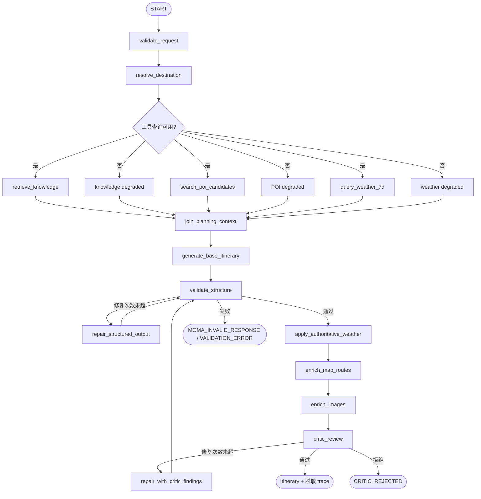

# 架构现状、P2 基线与 P3 状态图

状态基线：2026-10-13。本文件区分已经存在的 P2 链路和 P3 目标链路。P3 的完整任务、状态字段和验收门槛见 [P3 Agent 化规划](p3-plan.md)。

## P2 当前基线

当前 HTTP 路由由 `backend/app/main.py` 提供，`models/schemas.py` 定义旅行和版本契约，`services/` 完成生成、候选、地图、天气、图片、编辑、会话和有限编排，`integrations/` 封装 MoMA/高德，`cache/` 提供内存实现，`storage/` 提供 SQLite 行程版本存储。

P2 的实际生成顺序是：

```text
POST /api/trip/generate
  -> TripOrchestrator
       -> city_resolution
       -> knowledge_retrieval
       -> itinerary_generation
            -> ItineraryGenerator
                 -> candidate collection (内部)
                 -> MoMA
       -> candidate_quality
       -> map_enrichment
       -> weather_enrichment
       -> image_enrichment
       -> critic
  -> Itinerary
```

这个顺序是 P3 要改变的重点：P2 的天气和地图属于基础行程通过后的补全，天气没有进入基础 Planner 的决策上下文；候选搜索虽然发生在 Prompt 前，但封装在生成器内部，状态图看不见独立的候选节点。

## P3 目标依赖方向

```text
前端
  -> HTTP
    -> LangGraph Trip StateGraph
      -> deterministic nodes
      -> MCP tool adapters
        -> RAG / POI / weather / route integrations
      -> TripService / validator / Critic
      -> storage / cache
```

LangGraph 负责状态转移、条件边、有限重试、节点轨迹和中断恢复；业务 service 负责模型校验、来源真实性、预算与版本语义；MCP 负责工具发现和调用协议；供应商 integration 负责网络、超时、重试和响应解析。三层不能互相越权。

## P3 LangGraph 状态图



### 节点规则

- `validate_request`、`generate_base_itinerary`、`validate_structure` 和 `critic_review` 是硬门槛。
- `retrieve_knowledge`、`search_poi_candidates` 和 `query_weather_7d` 在城市解析之后并行，必须在基础生成之前汇聚。
- `query_weather_7d` 查询当前请求日期范围，最多覆盖 7 个日历日；供应商单次窗口不足时由 adapter 分片合并。
- `apply_authoritative_weather` 只把按日期匹配的供应商天气写入最终模型，不能接受模型伪造的 condition、温度或来源。
- 地图详情、路线和图片在生成后处理；路线依赖模型选出的候选 ID 和坐标，不回到候选搜索阶段。
- 可选工具失败写入 `degraded` 并继续；硬节点失败停止图并返回稳定错误。修复边必须有最大次数。

## 状态契约

状态包含 `graph_version`、`request_id`、已校验 `request`、`city_resolution`、`knowledge_chunks`、`candidate_pool`、`weather_context`、`planning_context_status`、`itinerary_draft`、`repair_attempts`、`critic_report` 和脱敏 `trace`。

状态只属于单次图执行。SQLite 继续保存完整行程版本和会话引用；LangGraph checkpoint 只能用于回放或中断恢复，不能替代 `expected_version` 冲突控制。

## P3 天气职责

基础生成前的天气是规划证据，用来决定室内/室外活动、时段和备选方案。最终响应中的天气字段仍由供应商记录按 `DayPlan.date` 权威回填。没有同日数据时为 `unknown`，不得将其解释为晴天；天气工具不可用时，Planner 必须采用不依赖具体天气事实的稳健方案。

P3 不在基础图内自动修改已保存行程。天气触发重规划读取当前版本、生成变更预览、等待用户确认后再写入新版本。

## 分层约束

- HTTP 层处理输入输出、错误码和依赖注入，不直接实现 Prompt、工具请求或数据库操作。
- Graph 节点只编排状态与分支，不复制地图、天气、预算和 POI 校验规则。
- service 层持有行程版本、局部编辑、Critic 和降级规则；所有修改最终经过 `Itinerary` 与跨字段校验。
- MCP 工具层使用白名单、Schema、超时、重试和来源字段；不允许模型任意改变用户硬约束。
- integration 层封装 MoMA、高德和其他供应商；原始响应不进入用户响应或 trace。
- RAG 检索返回带 `chunk_id/source/source_version` 的片段，不能把攻略文本当实时营业、价格、POI 或天气事实。
- 存储层保存完整行程版本；缓存层只加速可重建数据，不保存唯一业务事实。
- 前端以 [API 契约](api-contract.md) 和 OpenAPI 为准；天气与 POI 的真实性状态由后端提供。

## 兼容与回滚

`AGENT_RUNTIME=legacy` 保留 P2 `TripOrchestrator`；`AGENT_RUNTIME=langgraph` 使用 P3 图。切换期间保留 P2 Prompt、后置天气补全和已有 API 字段，允许按运行时开关回滚，不删除历史行程和会话数据。
