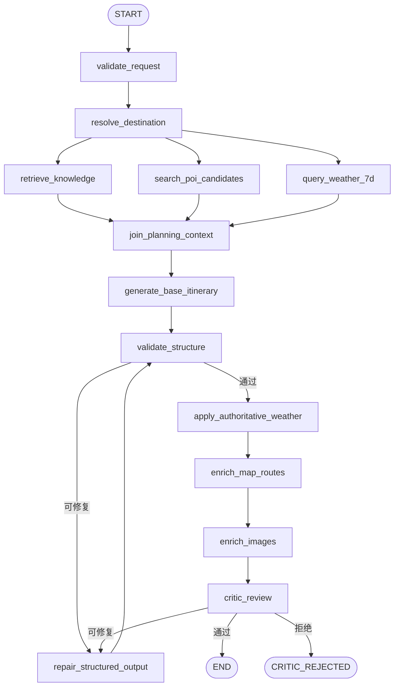

# P2 编排基线与 P3 LangGraph 状态图

## P2 基线

P2 的 `TripOrchestrator` 在 service 层提供有限步骤的同步编排，不依赖 LangGraph。它复用城市解析、候选池、知识检索、MoMA 生成、地图补全、天气补全、图片补全和规则 Critic。

P2 顺序如下：

1. 城市解析；
2. 按城市检索带来源的攻略片段；
3. 生成并校验基础行程，候选池由生成器内部采集；
4. 记录候选池覆盖状态；
5. 地图补全；
6. 天气补全；
7. 图片补全；
8. 规则 Critic。

P2 的第 5、6 步是生成后的可选增强，天气没有参与基础行程决策。该行为保留在 P2 历史验收中，但不再是 P3 的目标链路。

## P3 LangGraph 图

P3 使用有界 LangGraph `StateGraph` 表达同一业务链路，并把前置证据准备显式化：



`retrieve_knowledge`、`search_poi_candidates` 和 `query_weather_7d` 由城市解析节点触发后并行执行，在汇聚节点统一处理缺失和降级状态。基础 Planner 只能在 `join_planning_context` 后运行，因此 POI 和天气不会再是生成后的未知补丁。

## 节点契约

| 节点 | 输入 | 输出 | 失败策略 |
| --- | --- | --- | --- |
| `validate_request` | 原始 `TripRequest` | 已校验请求 | 硬失败，不调用外部工具 |
| `resolve_destination` | 目的地文本 | 规范城市、覆盖等级 | 省级/无效范围进入显式降级或请求错误 |
| `retrieve_knowledge` | 城市、偏好查询 | 带来源 RAG 片段 | 空命中/知识库故障为 `degraded` |
| `search_poi_candidates` | 城市、日期数、偏好 | 可信候选池和覆盖诊断 | 不足、跨城、无坐标不进入白名单 |
| `query_weather_7d` | 城市、开始日、结束日 | 最多 7 天按日天气证据 | 供应商失败为 `degraded`；缺失日期为 `unknown` |
| `join_planning_context` | 三类前置结果 | Planner 上下文和缺失状态 | 不隐藏缺失，写入 trace |
| `generate_base_itinerary` | 请求、候选、天气、RAG | 模型原始结构化草稿 | MoMA 超时/无效响应硬失败 |
| `validate_structure` | 草稿和请求 | 规范 `Itinerary` | 可修复错误进入有界修复，否则硬失败 |
| `apply_authoritative_weather` | Itinerary、天气证据 | 日期对齐的权威天气字段 | 不覆盖活动，只拒绝冲突事实 |
| `enrich_map_routes` | Itinerary、候选池 | POI 详情和路线 | 可选降级，不能伪造来源 |
| `enrich_images` | Itinerary、POI | 图片字段 | 可选降级 |
| `critic_review` | 最终候选、请求、Itinerary | Critic 报告 | 拒绝未通过的行程 |

## 状态与轨迹

P3 状态至少包含 `graph_version`、`request_id`、`request`、`city_resolution`、`knowledge_chunks`、`candidate_pool`、`weather_context`、`planning_context_status`、`itinerary_draft`、`repair_attempts`、`critic_report` 和 `trace`。

`StepRecord`/等价节点记录包含步骤名、状态、来源、耗时、降级原因和失败类别。轨迹不包含完整 Prompt、API Key、供应商原始响应或用户隐私全文。状态仅用于单次图执行，行程版本和会话版本仍由 SQLite 仓储负责。

## 7 天天气规则

- 请求日期范围当前允许 3 至 7 天，天气节点覆盖完整请求范围，最多 7 个日历日。
- 如果供应商单次只能查询较短窗口，天气 adapter 拆分请求并合并；图节点不把“供应商最多 4 天”暴露为业务限制。
- 按 `DayPlan.date` 和天气记录日期等值匹配；不按数组位置匹配，不把缺失记录前移或后移。
- 有供应商数据的日期是 `available`；无同日可信数据是 `unknown`，不能填 condition、温度或 source。
- 天气证据在生成前用于安排室内/室外活动、时段和备选；生成后只做权威字段回填和 Critic 校验。

## Critic 规则

- 目的地、日期范围和每日日期必须与请求一致；
- 总费用不能小于活动费用之和，且不能超过用户预算；
- `verified` POI 必须具有 ID、坐标和高德来源；存在可信候选池时，ID 必须属于该池；
- `verified` 路线必须具有可靠起终点坐标、路线对象和高德来源；
- `unknown` 天气不能携带天气状况、温度或来源等具体事实；
- 最终 `DayPlan.weather` 必须来自按日期对齐的天气证据，不能只依赖模型输出。

Critic 拒绝时抛出 `CriticRejectedError`，包含结构化 `CriticReport` 和截至失败点的脱敏轨迹。

## 限制、降级与回滚

`max_steps`、节点超时和修复上限共同限制图执行。同步 integration 的超时只能在调用返回后判定，不能强制终止底层网络调用；供应商客户端仍须设置网络超时和重试预算。

RAG、POI、天气、地图和图片失败时记录 `degraded`。候选不足时 Planner 收到明确的无白名单状态，不得伪造 POI；天气不可用时 Planner 只能使用不依赖具体预报的安排。生成、结构校验和 Critic 失败不能返回未校验行程。

P3 通过 `AGENT_RUNTIME=langgraph` 灰度，`AGENT_RUNTIME=legacy` 回滚到 P2 编排。回滚不删除行程版本、会话或历史数据。

## 离线验证

P2 基线：

```powershell
python -m pytest backend/tests/api/test_orchestration.py -q
```

P3 设计验收至少增加：3/4/7 天天气窗口、供应商部分覆盖、天气查询失败、POI/天气并行汇聚、生成前证据进入 Prompt、权威天气回填、修复上限和 LangGraph/legacy 结果对照。所有测试使用 fake integration，不访问真实密钥。
