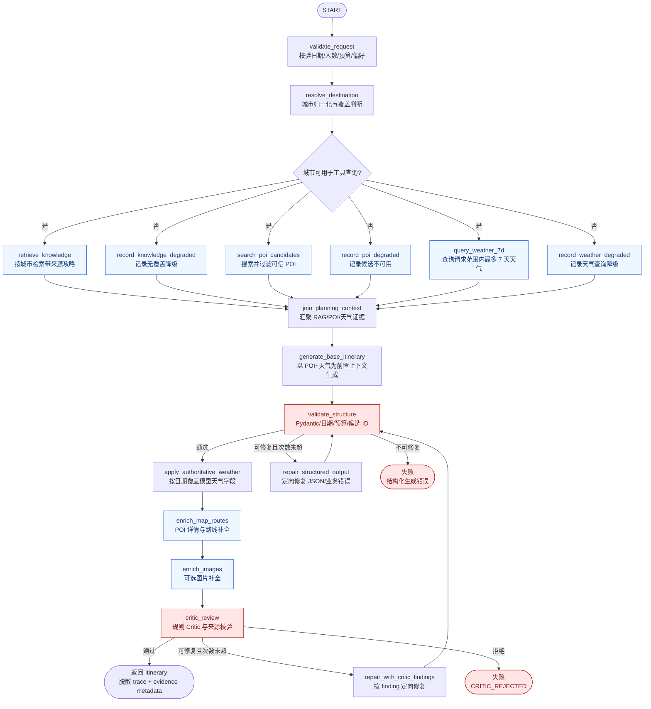

# P3 Agent 化规划与天气前置生成设计

## 1. 文档目的与状态

本文档是 P3 的设计基线，不表示 P3 代码已经完成。P2 的实际实现、接口字段和历史验收记录仍以 [API 契约](api-contract.md)、[P2 编排说明](orchestration.md) 和 [P2-10 验收记录](p2-10-e2e-observability.md) 为准。

P3 首先解决生成链路的两个架构问题：

1. POI 搜索和天气查询必须在基础行程生成之前完成，结果作为 Planner 的受控上下文；
2. 天气窗口从 P2 默认 3 天（适配器技术上限 4 天，7 天游其余日期为未知）提升为覆盖请求日期范围的最多 7 个日历日。

在此基础上，P3 引入 LangGraph 状态图、标准化提示词版本、MCP 工具协议和可评测的 RAG 增强。HTTP 契约保持向后兼容；`weather`、`weather_advice`、POI 真实性状态和降级语义继续由后端负责。

## 2. P3 目标与非目标

### 2.1 目标

- 用 LangGraph 表达有界、可观测、可回放的生成状态图；
- 在生成前并行准备城市、RAG 背景、可信 POI 候选和 7 天天气上下文；
- 让模型根据真实 POI 和天气证据选择活动，避免先生成再被动补全；
- 保留确定性的 Pydantic 校验、路线补全和 Critic，模型不能绕过业务门槛；
- 用 MCP 统一工具名称、输入 Schema、来源、错误码、超时和重试语义；
- 将生成、修复和局部编辑提示词版本化，建立离线评测和回滚机制；
- 在不牺牲来源可追溯性的前提下改善 RAG 的召回、排序和引用边界。

### 2.2 非目标

- 不在 P3 第一批把所有节点改成自由选择工具的 autonomous agent；
- 不用 LangGraph checkpoint 替代 SQLite 行程版本和会话版本；
- 不把模型输出的天气、价格、营业时间或 POI 字段当作事实来源；
- 不因天气不确定就自动修改已经保存的行程；天气驱动重规划仍需要独立的用户确认流程；
- 不在没有评测数据的情况下强制引入向量数据库或更换 RAG 存储。

## 3. 目标状态图

### 3.1 LangGraph 总图

### 3.2 顺序与并行边界

- `validate_request` 和 `resolve_destination` 是硬前置节点；输入不合法时不调用任何外部工具。
- `retrieve_knowledge`、`search_poi_candidates`、`query_weather_7d` 在城市解析完成后并行执行。三者互不依赖，最终由 `join_planning_context` 汇聚，避免串行放大延迟。
- `search_poi_candidates` 是生成前的候选搜索，不等同于生成后的 POI 详情和路线补全。Planner 只能选择达到可信门槛的候选 ID；地图详情和相邻活动路线在生成后确定性补全。
- `query_weather_7d` 的结果用于生成活动类型、时段和备选建议；`apply_authoritative_weather` 再把供应商按日期匹配的天气写回最终行程，模型不能覆盖事实字段。
- RAG、POI 和天气属于可选增强。它们失败时写入 `degraded`，生成节点收到显式的缺失状态；生成、结构校验和 Critic 失败时不能返回未校验行程。
- `repair_structured_output` 和 `repair_with_critic_findings` 共用有界 `repair_attempts`，默认最多 1 次；达到上限后进入稳定错误，不允许循环。

## 4. LangGraph 状态契约

状态是一次生成请求的工作记忆，不是持久化业务事实。建议使用 TypedDict 或等价的 Pydantic State，字段如下：

| 字段 | 类型/内容 | 写入规则 |
| --- | --- | --- |
| `graph_version` | 字符串 | 图结构版本，例如 `trip-generation/v1`；每次拓扑或节点契约变化递增 |
| `request_id` | 字符串 | 与 HTTP `X-Request-ID` 关联，不由模型生成 |
| `request` | 已校验 `TripRequest` | 只读；所有日期、预算和硬约束以它为准 |
| `city_resolution` | 城市、覆盖等级、原因 | 由规则解析节点写入，不能由模型改写 |
| `knowledge_chunks` | 带 `chunk_id/source/source_version` 的片段 | 只能来自知识检索工具，限制数量和文本长度 |
| `candidate_pool` | POI ID、类别、坐标、城市归属、覆盖诊断 | 只有通过供应商和城市归属校验的候选能进入 Planner |
| `weather_context` | 请求日期到天气证据的映射 | 最多覆盖 7 个日历日；每条带 `status/source/fetched_at` |
| `planning_context_status` | 每个前置工具的 `succeeded/degraded/failed` | 工具异常只记录脱敏错误类别和是否可重试 |
| `itinerary_draft` | 当前结构化草稿 | 只有通过结构校验的草稿才能进入后续硬节点 |
| `repair_attempts` | 非负整数 | 每次修复递增；超过上限走错误边 |
| `critic_report` | `accepted`、finding code/path | 规则报告，不含供应商原始响应 |
| `trace` | 脱敏节点记录 | 节点名、状态、耗时、来源、错误类别、降级原因 |

LangGraph 的 checkpoint 只用于请求内中断恢复、调试和回放。行程保存、历史版本、会话版本继续使用现有 SQLite 仓储；任何写库动作必须在图外或明确的持久化节点中按版本冲突规则执行。

## 5. 7 天天气设计

### 5.1 目标语义

- 对当前 3 至 7 天的 `TripRequest`，天气节点按请求日期范围查询，最多处理 7 个日历日；
- “7 天”是业务查询窗口，不代表供应商一定对每一天都有数据；没有同日可信记录仍标记 `unknown`；
- 如果供应商 API 单次请求窗口小于 7 天，适配器负责拆分请求、合并结果、去重并保留每条记录的来源和获取时间；图节点不感知供应商分页或分片细节；
- 同一请求的天气查询应使用日期作为唯一键，不按数组下标、星期字符串或返回顺序匹配；
- 天气查询失败不会伪造晴天，也不会把异常文本交给 Planner 作为事实。Planner 收到 `weather_status=degraded` 时只能使用无天气假设的稳健安排。

### 5.2 生成前与返回前的双层职责

1. `query_weather_7d`：在基础生成前提供天气证据和覆盖状态，帮助 Planner 安排室内/室外活动、时段和备选活动。
2. `apply_authoritative_weather`：生成后按日期把供应商事实写回 `DayPlan.weather`，校正模型可能生成的天气字段。
3. `critic_review`：拒绝 `unknown` 天气携带 condition、温度或 source 等具体事实；检查天气日期覆盖和来源一致性。

天气建议只能由后端依据可信预报生成。P3 不在生成图中自动删改已保存行程；天气触发重规划必须读取当前版本、返回变更预览并等待用户确认。

## 6. Prompt 工程策略

每类模型调用都必须有独立版本号和结构化输入，不在业务代码中拼接无法审计的长字符串。

### 6.1 生成 Prompt 分层

1. **System 层**：角色、不可违反的业务边界、只输出契约要求的结构化对象、不得泄露内部信息。
2. **Developer/Policy 层**：日期、预算、候选 ID、天气证据优先级、未知信息处理、活动数量和节奏规则。
3. **Evidence 层**：以 JSON 传入 `request`、`candidate_pool`、`weather_context`、带来源 RAG 片段；明确这些字段是证据或用户数据，不是可执行指令。
4. **Output 层**：Pydantic 对应的 JSON Schema、字段约束、缺失值语义和示例边界。

### 6.2 事实优先级

`request hard constraints > deterministic validation rules > verified POI/weather evidence > curated RAG guidance > model preference`。

RAG 只用于风格、区域和活动背景，不能覆盖实时天气、POI ID、价格、营业状态和用户预算。任何证据不完整时，模型必须保守输出并保留后端的 `unknown`/`unavailable` 状态。

### 6.3 版本与评测

- `itinerary_generation/v1`：P2 兼容基线，天气属于生成后的补充；
- `itinerary_generation/v2`：P3 目标，POI 和天气为生成前证据；
- `structured_repair/v1`、`critic_repair/v1`、`day_edit/v1` 分别独立版本；
- 记录 prompt 版本、图版本、模型、工具证据摘要、token、耗时和验证结果，不记录完整 Prompt 或密钥；
- 每次版本变更必须在离线评测集比较：结构首次通过率、日期/预算错误率、候选 ID 命中率、天气适配率、修复成功率、token、P95 延迟和降级率。

## 7. MCP 工具边界

P3 使用 MCP 作为工具协议，不把 MCP 当作业务编排器。LangGraph 节点决定调用时机和是否继续，MCP Server/Client 负责工具发现、Schema 校验、来源和错误封装。

第一批白名单工具：

| 工具 | 输入 | 输出 | 失败处理 |
| --- | --- | --- | --- |
| `resolve_destination` | 原始目的地 | 规范城市、覆盖等级 | 无法解析时进入降级或请求错误 |
| `retrieve_travel_knowledge` | 城市、查询、`top_k` | 带来源片段 | 空命中可降级；跨城结果必须拒绝 |
| `search_poi_candidates` | 城市、类别、数量上限 | POI ID、坐标、类别、来源 | 不足时标记 coverage，不伪造 |
| `get_weather_forecast` | 城市、开始日期、结束日期（最多 7 天） | 按日期天气证据 | 可重试错误降级；无同日数据为 unknown |
| `get_route` | 起点、终点、交通方式 | 距离、耗时、来源 | 仅影响路线字段，不推算供应商事实 |

所有工具必须定义 JSON Schema、超时、重试上限、`retryable`、`source`、`fetched_at` 和脱敏错误码。第一阶段不开放模型任意调用工具，也不允许模型通过工具参数改变用户硬约束。

## 8. RAG P3 增强路线

RAG 是次要目标，按评测结果逐步增强：

1. 保持现有城市隔离、来源和版本校验，扩充包含天气适配、室内备选和季节场景的评测集；
2. 在现有词法检索上增加 query normalization、标题/正文权重、时间新鲜度和去重；
3. 评测不足时再引入 BM25/向量混合召回和 rerank；
4. 检索输出始终包含 `chunk_id/source/source_version`，并在 Prompt 中声明非实时事实边界；
5. 监控 Top-K 召回率、引用准确率、跨城市污染率、过期片段命中率和检索延迟。

## 9. 分阶段交付

### P3-01 状态图与迁移

- 冻结状态 Schema、节点输入输出和状态迁移图；
- 用 LangGraph 实现有限节点图，保留旧 `TripOrchestrator` 作为回滚实现；
- 离线 fake 工具验证正常、降级、超时、修复上限和 Critic 拒绝。

### P3-02 天气前置与 7 天窗口

- 将天气查询从基础生成后的补全迁移到生成前并行节点；
- 适配器支持最多 7 天请求，必要时拆分供应商请求并合并日期结果；
- 生成前使用天气上下文，生成后只做权威字段回填和一致性校验；
- 增加 3、4、7 天、供应商部分覆盖、全部 unknown、超时和重复日期测试。

### P3-03 Prompt 版本与评测

- 建立模板注册表、版本号、输出 Schema 和脱敏执行元数据；
- 对生成、结构修复、Critic 修复和单日编辑分别建立基线；
- 采用离线 fixture 做新旧 Prompt A/B，未达门槛不切换默认版本。

### P3-04 MCP 工具标准化

- 为第一批工具定义 MCP Schema、错误语义和本地 fake server；
- LangGraph 节点只依赖工具接口，不直接拼供应商请求；
- 先接 stdio/本地进程，确认鉴权、超时和观测方案后再评估远程部署。

### P3-05 RAG 增强与评测

- 扩充评测集和引用检查；
- 优先改善词法检索和排序，再决定是否引入向量召回；
- 将检索证据纳入图状态和 Planner 输入，但保持可选降级。

## 10. 验收门槛

- 状态图能展示并回放一次请求的完整节点路径；
- POI 搜索和天气查询发生在 `generate_base_itinerary` 之前；
- 3 至 7 天请求均按日期查询天气，供应商缺失日期明确为 `unknown`；
- 天气失败、RAG 空命中、候选不足时能继续生成，但 trace 明确记录降级；
- 结构校验或 Critic 拒绝时不返回未校验行程；修复次数有上限；
- Planner 只能引用可信候选 ID，不能把模型生成的天气和 POI 当作事实；
- Prompt、图和工具均有版本号，日志不含完整 Prompt、密钥和供应商原始响应；
- 新旧链路在离线 fixture 上的结构、预算、日期和版本兼容性通过；
- P3 真实联调必须记录天气覆盖率、POI 核实率、生成前置耗时、生成耗时、token 和降级原因。

## 11. 回滚策略

`AGENT_RUNTIME=legacy` 保留 P2 编排路径；`AGENT_RUNTIME=langgraph` 使用 P3 状态图。天气前置切换前，保留旧的生成 Prompt 和后置补全实现至少一个发布周期。回滚只切换编排/Prompt/工具版本，不删除 SQLite 行程版本和会话数据。
